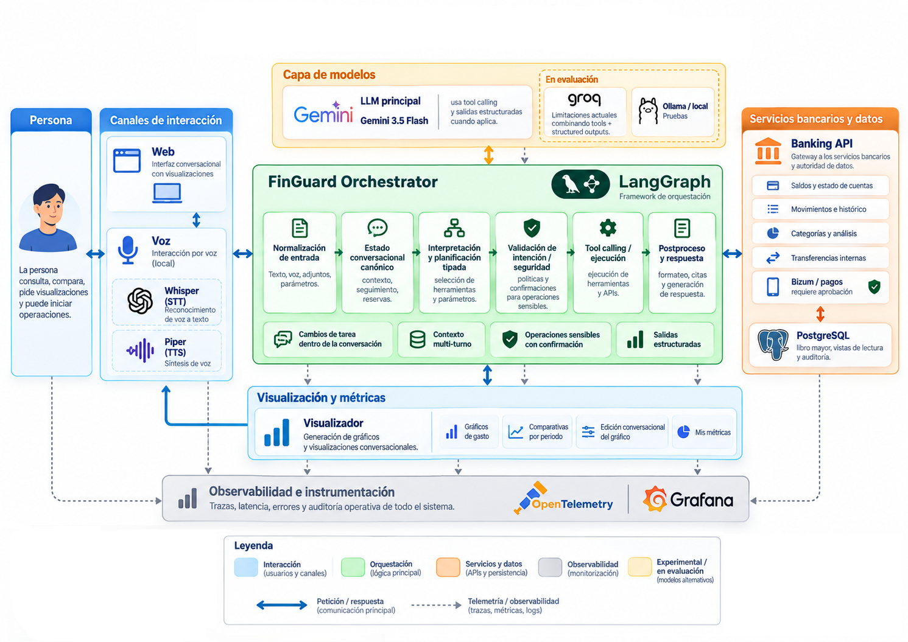
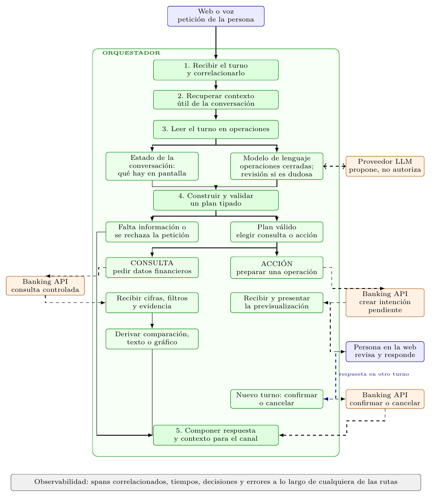
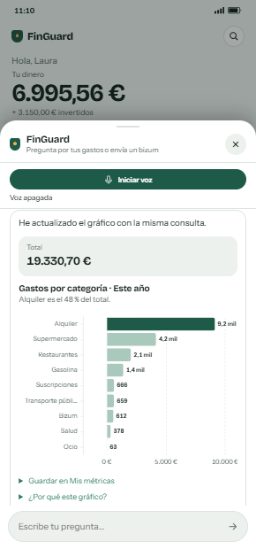
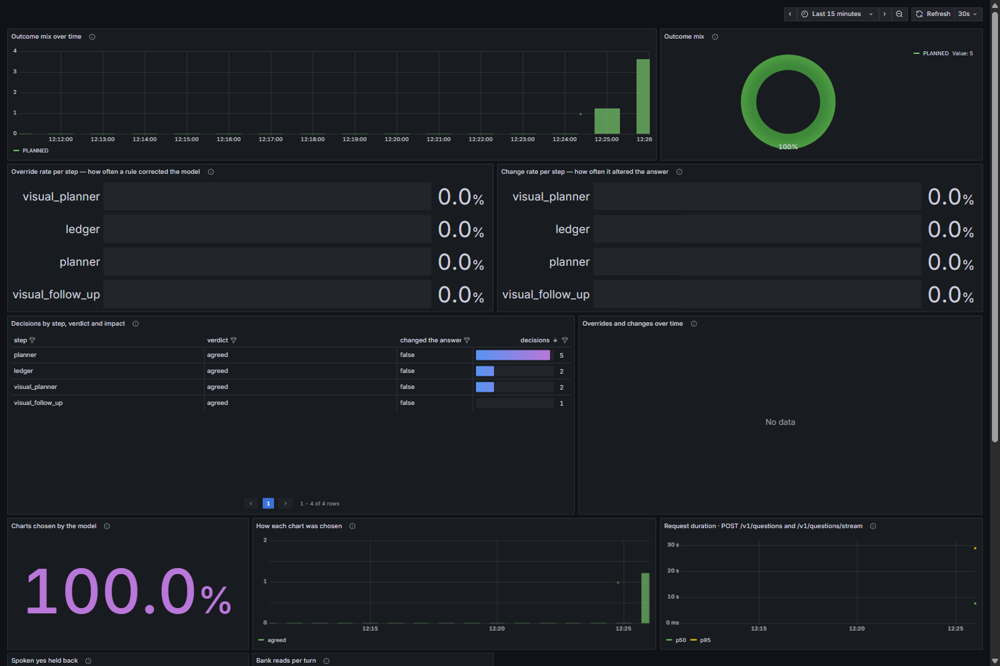
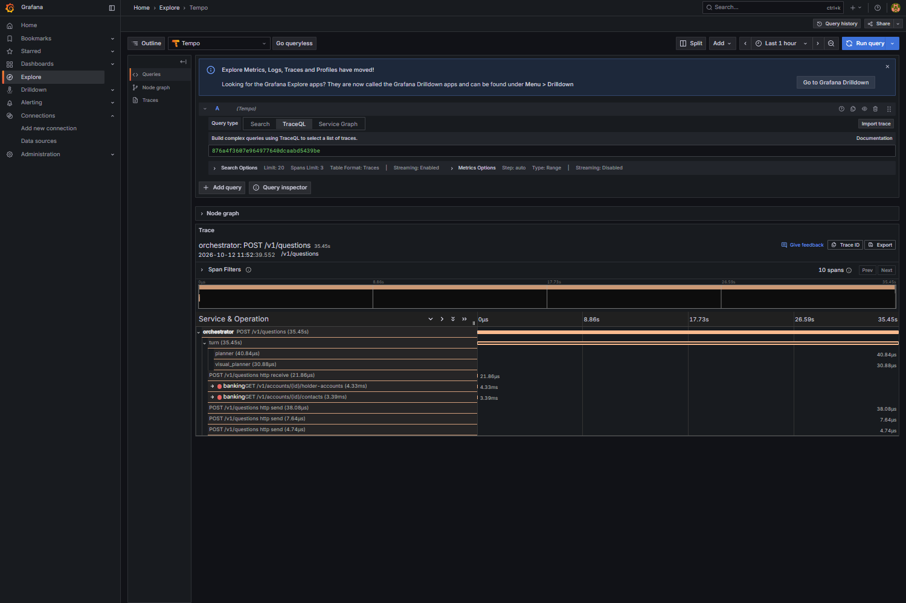

# FinGuard

A proof of concept of a conversational financial assistant. A person asks about their accounts in
plain Spanish, by text or by voice, explores the answer with charts, and prepares a Bizum or a
transfer, without ever giving a language model the power to read the database or move money.

> FinGuard interprets. Deterministic services validate. The user authorises. The system executes.

Everything runs locally on synthetic data: accounts, movements, contacts and payments are a
generated dataset, and no real bank is connected.

## Contents

- [What it does](#what-it-does)
- [Architecture](#architecture)
- [How a turn works](#how-a-turn-works)
- [Charts on the conversation](#charts-on-the-conversation)
- [Payments: preview first, money only on a button](#payments-preview-first-money-only-on-a-button)
- [Observability](#observability)
- [Services](#services)
- [Running it](#running-it)
- [Tests and evaluation](#tests-and-evaluation)
- [Limits](#limits)
- [Documentation](#documentation)

## What it does

| Capability | State |
| --- | --- |
| Balances, movements, spending by category, merchant or month, rankings, averages | Working, from text and from voice |
| Comparing two periods, following up on the answer on screen («¿y el mes anterior?», «compáralo con el actual») | Working |
| Charts of an answer, edited by talking to them («ponlo en horizontal», «top 3»), saved in «Mis métricas» | Working; a saved metric re-runs its query when opened |
| Preparing a Bizum or a transfer between own accounts, confirming or cancelling it | Working; confirmation only from the web |
| Voice: speech to text, the answer spoken back, interrupting it, one conversation shared with text | Working, with local Whisper and Piper |
| Booking a class with external gyms over A2A | Built and tested on its own; not connected to the conversation |

## Architecture



The system is split by responsibility, and each part runs as its own service:

- **Channels.** A React web app and a voice gateway. Both talk to the same orchestrator, with the
  same conversation.
- **Orchestrator.** A LangGraph graph that keeps the conversation's state, asks a language model
  to read each turn, validates what the model proposes and decides the next step.
- **Model layer.** Gemini 3.5 Flash for the demo; Ollama for local models. The model only ever
  returns closed, typed operations.
- **Banking API.** The only service that reads or writes financial data. It owns PostgreSQL, the
  double-entry ledger, holder-scoped views and the audit trail.
- **Observability.** OpenTelemetry traces and metrics, collected into Tempo, Prometheus and
  Grafana. It is optional, and a failure in it never fails a turn.

The services share no code and no database: each has its own dependencies, lockfile, Dockerfile,
tests and database role.

## How a turn works



1. **Receive.** The turn arrives with the holder's identity and an idempotency key. If it continues
   a conversation, it names the conversation and the version it last saw; a turn sent against an
   older version is refused rather than allowed to overwrite another.
2. **Read.** The orchestrator loads the conversation's state from PostgreSQL and describes it to the
   model *without figures*: the query on screen, the keys of the result shown (months, categories,
   merchants, never amounts), the open question, the task's accounts. The model returns
   operations such as `Ask`, `Patch`, `Compare`, `Visualize` or `PrepareBizum`.
3. **Validate.** Code, not the model, applies those operations: a correction changes only the
   fields it names, a new question starts from scratch, a payment is a task of its own. A reading
   that looks wrong for the state (inherited filters, a new payment) gets a second reading.
4. **Execute.** A valid plan becomes a typed query to the Banking API, which compiles it into
   parameterised SQL over the holder's own views. The model never writes SQL and never adds up a
   figure.
5. **Answer and save.** The answer, the chart and the new state are written together, conditioned
   on the previous version. A retried turn gets the stored answer back instead of running twice;
   an interrupted one resumes from its LangGraph checkpoint.

## Charts on the conversation



A chart is built from the bank's result, never from figures the model writes. The model may propose
a chart as a closed structure (type, axes, order, limit), and a verifier with nine rules accepts
or rejects it. Who decides the chart is a named mode:

| Mode | Chart shown |
| --- | --- |
| `deterministic` | The rules' reference chart; the model is not asked |
| `shadow` | The reference; the model's proposal is only verified and recorded |
| `hybrid` | The model's proposal when it passes the verifier in time; otherwise the reference |
| `promoted` | The verified proposal even where the rules have no chart; the rules as fallback |

The demo runs `hybrid` with Gemini and a 30 s budget for the proposal. A local model stays at
`deterministic`, because its proposals did not earn it (see [evaluation](#tests-and-evaluation)).

Editing a chart («ponlo en barras», «de menor a mayor») changes the presentation and reuses the
same data; asking about another period or a bar («¿por qué agosto es tan alto?») runs a new query.

## Payments: preview first, money only on a button

«Envía 25 euros a Laura» prepares a payment; it does not make one.

1. The model reads the sentence as a Bizum; a new payment always gets a second reading.
2. The orchestrator resolves the contact. Two Lauras means a question, never a guess.
3. The Banking API creates a pending intent and returns a preview: recipient, amount, source
   account, balance after, expiry. No money has moved.
4. The holder confirms with «Sí, enviar» or cancels with «No» on screen. The bank checks the
   intent, the balance and the limit again, then books the payment in the ledger. Replaying the
   same intent returns the same receipt without charging twice.

A spoken «sí» never confirms: a transcript is a guess, and «sí» is the word that moves money.
Voice can prepare a payment and read its preview, but the decision is made on screen.

## Observability

| Decisions in Grafana | One turn in Tempo |
| --- | --- |
|  |  |

The graph records its decisions as it takes them: what the model read, whether a second reading
was needed, what the bank was asked, who chose the chart, and whether a spoken «sí» was held back.
Each decision is a span and a counter increment, so a panel and a trace show the same set. A
conversation identifier links every turn of one conversation in Tempo. Neither the question's text
nor names reach the telemetry. See [docs/architecture/observability.md](docs/architecture/observability.md).

## Services

| `apps/` | Responsibility |
| --- | --- |
| [`web`](apps/web) | React + TypeScript + Vite. Accounts, movements, cards, finances, the conversation sheet, charts (Vega-Lite), voice and payment confirmation |
| [`orchestrator`](apps/orchestrator) | Python + FastAPI + LangGraph. Conversation state, the model's reading, validation, charts, payments flow, telemetry |
| [`banking-api`](apps/banking-api) | Python + FastAPI + PostgreSQL. Accounts, ledger, balances, contacts, Bizum and transfers, audit. The only writer of financial data |
| [`voice-gateway`](apps/voice-gateway) | WebSocket audio, Faster Whisper speech-to-text, Piper text-to-speech, interruption |
| [`a2a-gateway`](apps/a2a-gateway) | The one process that speaks A2A 1.0, as a client: trusted-agent registry, Agent Card conformance, reply limits ([ADR-012](docs/architecture/adr-012-a2a-consumer-gateway.md)) |
| [`simulated-gym-agent`](apps/simulated-gym-agent) | Stand-in third parties for A2A: two gyms answering in different formats and one the gateway refuses |

The orchestrator and the Banking API follow a hexagonal architecture with command and query buses:
`domain` holds the rules and declares the ports, `application` the use cases, `infrastructure` the
adapters (FastAPI, HTTP clients, PostgreSQL, model providers) and `bootstrap` wires them. In the
orchestrator, a test reads the imports on every run and fails if a layer points outwards.

## Running it

Requirements: Docker, [uv](https://docs.astral.sh/uv/), [just](https://just.systems/) and Node 22.
For the local model, [Ollama](https://ollama.com/) on the host with `qwen2.5-coder:7b` pulled.

```bash
just hooks      # the pre-commit hook, once per clone
just install    # dependencies of every service, the web client included
just back       # PostgreSQL + banking-api + orchestrator, waiting until healthy
just migrate    # both service-owned schemas
just seed       # the synthetic dataset, checked to add up (it TRUNCATEs the ledger first)
cp apps/web/.env.example apps/web/.env.local
just web        # the client on http://127.0.0.1:3000
```

**The demo, as recorded.** Gemini, real speech both ways and the decisions in Grafana, in one start:

```bash
# once: ORCHESTRATOR_GEMINI_API_KEY=... in apps/orchestrator/.env (gitignored)
just voice-models   # once: downloads the Spanish Piper voice and Whisper medium
just demo           # Grafana on http://127.0.0.1:3001 (admin / admin)
just web
```

Other useful recipes: `just voice` (voice with fake speech providers), `just gemini` (Gemini without
voice or telemetry), `just a2a` (the A2A gateway and the simulated gyms), `just ask "¿cuánto
gasté este mes?"`, `just logs`, `just down`, `just reset`. `just` on its own lists them all.

Everything is published on `127.0.0.1` only, because the development credentials are trivial:

| Service | Port |
| --- | --- |
| Web client | 3000 |
| Orchestrator | 8000 |
| Banking API | 8001 |
| Voice gateway | 8002 |
| A2A gateway | 8003 |
| Simulated gyms | 9101–9103 |
| PostgreSQL | 5442 |
| Grafana | 3001 |

## Tests and evaluation

```bash
just check      # ruff + mypy + tests for every Python service, plus the client's types, tests and build
just test-unit  # without a database
```

Each service has its own suite, tested at its own boundary. The orchestrator replaces its ports
with in-memory fakes, so a whole turn runs without network, GPU or database. The Banking API runs
against a real PostgreSQL, each test inside a transaction that is never committed. The web compiles
every chart family the orchestrator exports. Continuous integration runs the five Python services
on Linux and Windows, the web build, and a PostgreSQL job that applies the migrations, runs the
bank's full suite and checks the query engine's accuracy.

The project is test-driven: every plan starts its tasks with failing tests, a defect is reproduced
by a test before it is fixed, and tests are named as behaviours
(`test_a_caller_may_read_only_its_own_account`).

**Real conversations.** The same 121 turns, against the running stack and the seeded bank, judged
turn by turn against what each one meant, with every checkable total recomputed in SQL:

| Model | Complete | Partial | Failed | Median turn |
| --- | ---: | ---: | ---: | ---: |
| Gemini 3.5 Flash | 100 | 13 | 8 | 7.6 s |
| Gemini 3.5 Flash-Lite | 97 | 6 | 18 | 2.2 s |
| qwen3.5:9b on Ollama (8 GB laptop GPU) | 24 | 22 | 75 | 5.1 s |

No total disagreed with the ledger in any run. The local model reads explicit questions but not the
conversation around them. See the [Gemini comparison](apps/orchestrator/evaluation/real/2026-10-11-model-comparison.md),
the [local model run](apps/orchestrator/evaluation/real/2026-10-13-local-qwen35-9b.md) and
[how real conversations are run and judged](apps/orchestrator/evaluation/real/README.md).

## Limits

- Synthetic data and development credentials. Identity is a development token table, not bank
  authentication; internal traffic is not hardened like a production network; secrets
  management and operational limits are missing.
- The A2A gateway is not called by the conversation since the move to LangGraph.
- A comparison broken down by category, saving a metric from the conversation, and other
  languages ([ADR-008](docs/architecture/adr-008-language-packs.md)) are not built.
- Voice has no automatic end-of-speech detection: the holder taps to send.

What is open, in order, is in [docs/next.md](docs/next.md).

## Documentation

- [docs/memoria-finguard.tex](docs/memoria-finguard.tex): the project report (Spanish), with these
  figures.
- [docs/vision.md](docs/vision.md): product vision, architecture, data model and security.
- [docs/architecture/adr-013-langgraph-conversation-runtime.md](docs/architecture/adr-013-langgraph-conversation-runtime.md):
  the conversation runtime, recovery and concurrency.
- [docs/conversational-capabilities.md](docs/conversational-capabilities.md): which capabilities
  are active, and on what evidence.
- [docs/architecture/development-rules.md](docs/architecture/development-rules.md) and
  [docs/architecture/monorepo.md](docs/architecture/monorepo.md): how the repository is built.
- [docs/audits/2026-08-28-do-the-tests-prove-anything.md](docs/audits/2026-08-28-do-the-tests-prove-anything.md):
  what the suite proves, measured by breaking the code on purpose.

Code, comments, tests and documentation are in English. The data (merchant names, movement
descriptions, the questions people ask) stays in Spanish: it is what a Spanish-speaking holder says
and reads.

## License

[MIT](LICENSE) © 2026 Adriano García-Giralda Milena. The speech and language models the
project downloads at runtime (the Piper voice, Whisper, the Ollama and Gemini models) are not part
of this repository and keep their own licences.
