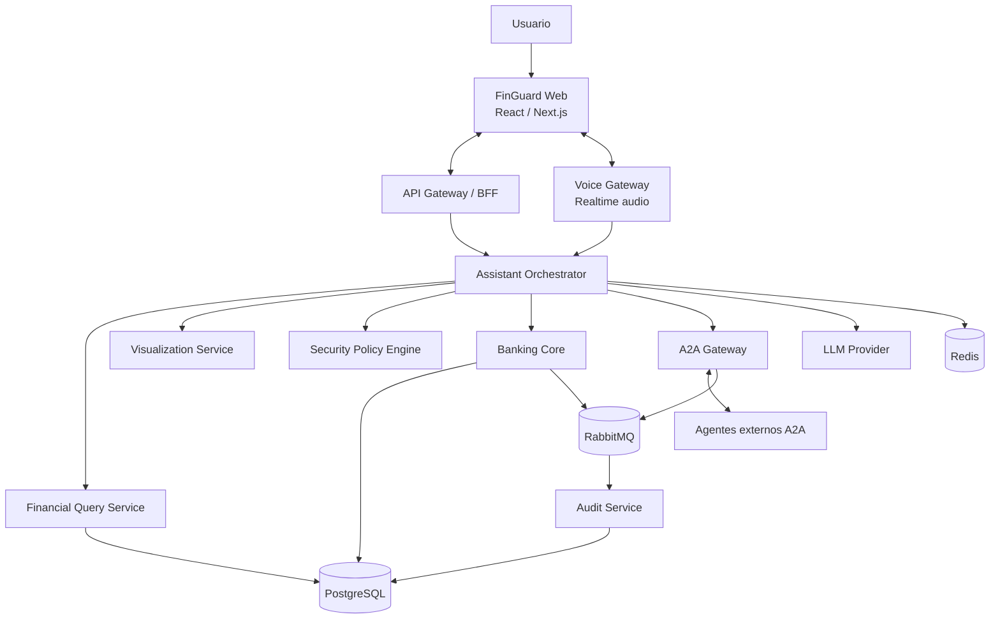
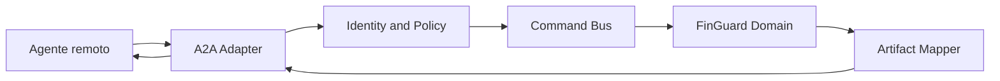
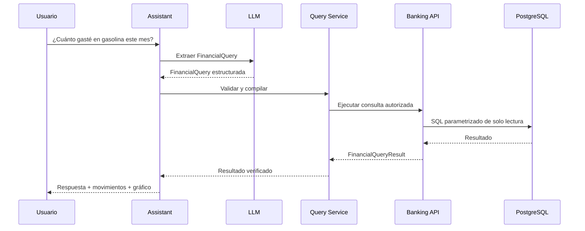
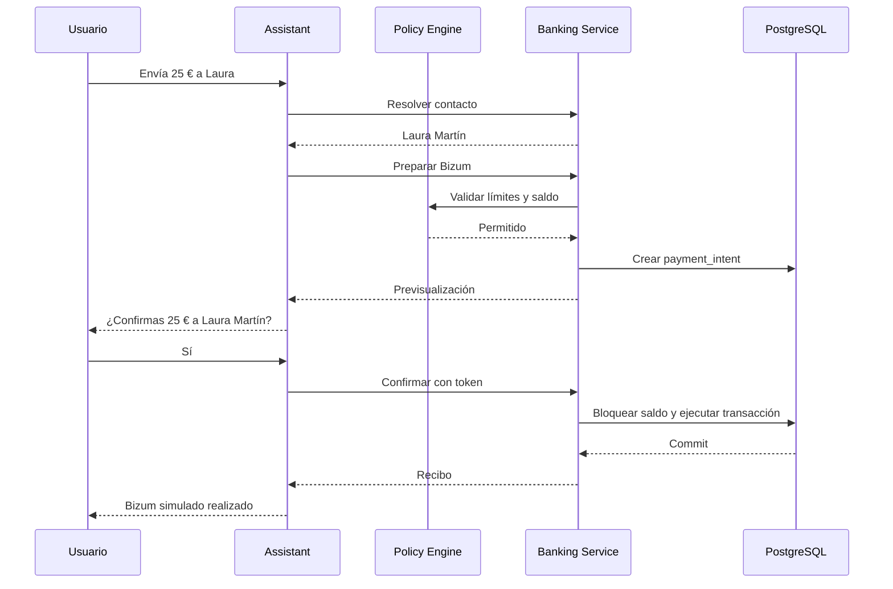

# FinGuard Engine

> Especificación funcional y técnica

## Tabla de contenidos

1. [Resumen ejecutivo](#1-resumen-ejecutivo)
2. [Visión del producto](#2-visión-del-producto)
3. [Objetivos](#3-objetivos)
4. [Principios de diseño](#4-principios-de-diseño)
5. [Arquitectura general](#5-arquitectura-general)
6. [Estrategia de microservicios](#6-estrategia-de-microservicios)
7. [Preparación para A2A](#7-preparación-para-a2a)
8. [Base de datos](#8-base-de-datos)
9. [Motor de consultas financieras](#9-motor-de-consultas-financieras)
10. [Motor de visualización](#10-motor-de-visualización)
11. [Flujo seguro de Bizum](#11-flujo-seguro-de-bizum)
12. [Seguridad](#12-seguridad)
13. [Contratos externos iniciales](#13-contratos-externos-iniciales)
14. [Tecnologías](#14-tecnologías)
15. [Estructura del repositorio](#15-estructura-del-repositorio)
16. [Escenario principal de demostración](#16-escenario-principal-de-demostración)
17. [Decisiones arquitectónicas iniciales](#17-decisiones-arquitectónicas-iniciales)
18. [Riesgos](#18-riesgos)
19. [Definición de terminado](#19-definición-de-terminado)
20. [Mensaje de presentación](#20-mensaje-de-presentación)

Las fases, fechas y métricas de éxito viven en [roadmap.md](roadmap.md).

---

## 1. Resumen ejecutivo

**FinGuard** es un motor financiero conversacional, modular y seguro que permite consultar información bancaria y preparar operaciones mediante lenguaje natural.

El usuario podrá interactuar por texto o voz para:

- Consultar su saldo.
- Analizar movimientos financieros.
- Formular preguntas temporales y comparativas.
- Preparar y confirmar envíos simulados mediante Bizum.
- Obtener visualizaciones generadas dinámicamente.
- Mantener conversaciones contextuales sobre sus finanzas.

El sistema se diseñará desde el principio para evolucionar hacia un asistente financiero completo y para interoperar con agentes externos mediante el protocolo Agent-to-Agent — A2A.

La seguridad será una propiedad estructural del sistema, no una capa añadida posteriormente. El modelo generativo podrá interpretar intenciones y redactar respuestas, pero **no** tendrá acceso directo a la base de datos ni capacidad autónoma para ejecutar movimientos de dinero.

> **FinGuard interpreta. Los servicios deterministas validan. El usuario autoriza. El sistema ejecuta.**

---

## 2. Visión del producto

### 2.1. Propuesta de valor

FinGuard permite que el usuario se relacione con sus finanzas mediante una conversación natural, eliminando la necesidad de navegar por numerosos menús y filtros.

Ejemplos:

> «¿Cuánto he gastado en gasolina este mes?»
>
> «¿Y cuánto gasté el mes anterior?»
>
> «Compáralo por semanas.»
>
> «¿Qué movimiento explica el aumento?»
>
> «Envía 25 euros por Bizum a Laura para la cena.»

El sistema debe responder utilizando información verificable y mostrar los movimientos que sustentan cada cálculo.

### 2.2. Evolución prevista

```text
FinGuard Engine
    │
    ├── FinGuard Assistant
    │      Aplicación conversacional para el cliente
    │
    ├── FinGuard Voice
    │      Interacción de voz en tiempo real
    │
    ├── FinGuard Insights
    │      Consultas, análisis y visualizaciones
    │
    ├── FinGuard Actions
    │      Operaciones financieras controladas
    │
    └── FinGuard Connect
           Interoperabilidad A2A con agentes externos
```

---

## 3. Objetivos

### 3.1. Objetivos funcionales

- Permitir conversaciones por texto y voz.
- Consultar el saldo disponible.
- Consultar y agregar movimientos mediante lenguaje natural.
- Resolver referencias temporales como:
  - Hoy.
  - Esta semana.
  - El mes anterior.
  - Los últimos tres meses.
- Mantener contexto entre mensajes sucesivos.
- Preparar y confirmar operaciones Bizum simuladas.
- Generar una visualización adaptada a cada respuesta.
- Mostrar la procedencia de los resultados.
- Registrar las decisiones y operaciones relevantes.
- Exponer capacidades seleccionadas mediante A2A.

### 3.2. Objetivos técnicos

- Mantener separados el razonamiento probabilístico y la ejecución determinista.
- Diseñar servicios sustituibles mediante contratos explícitos.
- Evitar dependencias directas entre el dominio y los proveedores de IA.
- Garantizar idempotencia en operaciones financieras.
- Mantener un registro financiero inmutable.
- Incorporar autorización humana antes de cualquier movimiento.
- Permitir sustituir:
  - El proveedor LLM.
  - El proveedor de voz.
  - La base de datos analítica.
  - El sistema de visualización.
  - La API bancaria simulada.
- Preparar el sistema para funcionar como cliente y servidor A2A.

### 3.3. Fuera del alcance inicial

- Operaciones bancarias reales.
- Asesoramiento financiero regulado.
- Inversiones o compraventa de activos.
- Solicitud automática de préstamos.
- Acceso a cuentas bancarias reales.
- Decisiones financieras autónomas sin confirmación.
- Entrenamiento de un modelo fundacional propio.
- Microservicios desplegados en Kubernetes durante la primera fase.

---

## 4. Principios de diseño

### 4.1. Seguridad por diseño

Toda acción financiera debe pasar por:

```text
Intención
   ↓
Estructura validada
   ↓
Política de seguridad
   ↓
Previsualización
   ↓
Confirmación explícita
   ↓
Ejecución idempotente
   ↓
Auditoría
```

### 4.2. El LLM no es una fuente de verdad

El modelo **podrá**:

- Interpretar la intención.
- Extraer parámetros.
- Seleccionar una herramienta.
- Explicar resultados.
- Proponer una visualización.

El modelo **no podrá**:

- Inventar saldos o importes.
- Consultar directamente las tablas bancarias.
- Construir SQL sin validación.
- Modificar registros financieros.
- Confirmar una operación en nombre del usuario.
- Alterar reglas de seguridad.
- Decidir si una operación ya ha sido autorizada.

### 4.3. Contratos antes que implementaciones

Cada capacidad se definirá mediante un contrato independiente:

```python
class BankingPort(Protocol):
    async def get_balance(self, account_id: UUID) -> Balance:
        ...

    async def prepare_bizum(
        self,
        command: PrepareBizumCommand,
    ) -> PaymentPreview:
        ...

    async def confirm_bizum(
        self,
        command: ConfirmBizumCommand,
    ) -> PaymentReceipt:
        ...
```

El orquestador conocerá el contrato, pero no la base de datos ni los detalles de implementación.

### 4.4. Separación entre dominio y protocolos

Los objetos internos no dependerán de:

- A2A.
- OpenAI.
- Gemini.
- FastAPI.
- PostgreSQL.
- RabbitMQ.
- Vega-Lite.

Los protocolos y proveedores se implementarán como adaptadores externos.

---

## 5. Arquitectura general



---

## 6. Estrategia de microservicios

El sistema se diseñará como servicios independientes, pero la separación lógica no obliga a desplegar inmediatamente cada módulo en un contenedor diferente.

### 6.1. Servicios desplegables

#### 6.1.1. `finguard-assistant`

Responsabilidades:

- Mantener el contexto conversacional.
- Clasificar la intención.
- Coordinar herramientas.
- Generar respuestas.
- Gestionar solicitudes de visualización.
- Aplicar las reglas conversacionales.
- Integrarse con proveedores LLM.

No será propietario de cuentas ni movimientos bancarios.

#### 6.1.2. `finguard-banking`

Responsabilidades:

- Gestionar cuentas ficticias.
- Mantener el libro mayor.
- Consultar saldos.
- Exponer movimientos.
- Gestionar contactos.
- Preparar operaciones Bizum.
- Confirmar operaciones.
- Aplicar idempotencia.
- Publicar eventos financieros.

Será el único servicio con permiso de escritura sobre los datos financieros.

#### 6.1.3. `finguard-voice`

Responsabilidades:

- Recibir audio en streaming.
- Detectar el final de turno.
- Transcribir.
- Gestionar interrupciones.
- Sintetizar la respuesta.
- Mantener sesiones realtime.

No tendrá conocimiento del dominio bancario.

#### 6.1.4. `finguard-a2a`

Responsabilidades:

- Publicar el Agent Card.
- Actuar como servidor A2A.
- Actuar como cliente A2A.
- Descubrir agentes autorizados.
- Traducir tareas A2A a comandos internos.
- Traducir resultados internos a artefactos A2A.
- Gestionar estados y trazabilidad de tareas externas.

#### 6.1.5. `finguard-audit`

Responsabilidades:

- Consumir eventos de dominio.
- Mantener una auditoría append-only.
- Registrar accesos, consultas y operaciones.
- Proporcionar trazabilidad para la demo y la evaluación.

#### 6.1.6. `finguard-web`

Responsabilidades:

- Chat.
- Captura y reproducción de audio.
- Visualizaciones.
- Confirmaciones de operaciones.
- Presentación de movimientos utilizados.
- Estado de herramientas y tareas.

### 6.2. Despliegue inicial recomendado

Para evitar complejidad prematura:

```text
Fase inicial
├── finguard-web
├── finguard-assistant
├── finguard-banking
└── PostgreSQL

Fase intermedia
├── finguard-voice
├── RabbitMQ
└── finguard-audit

Fase avanzada
└── finguard-a2a
```

Aunque algunos módulos compartan inicialmente un proceso, sus contratos y dependencias deben permitir separarlos sin modificar el dominio.

---

## 7. Preparación para A2A

### 7.1. Papel de A2A

A2A se utilizará para interoperar con agentes externos, no como sustituto de todos los protocolos internos.

El estándar define conceptos como Agent Card, Task, Message, Part y Artifact. Una tarea representa una unidad de trabajo con estado, mientras que los resultados concretos deben devolverse como artefactos asociados a la tarea.

FinGuard podrá asumir los dos roles:

- **A2A Server** — un agente externo solicita una capacidad a FinGuard.
- **A2A Client** — FinGuard solicita una capacidad a otro agente.

### 7.2. Adaptador A2A



El dominio no recibirá objetos del SDK A2A. El adaptador transformará:

```text
A2A Message
    ↓
Internal Command
    ↓
Domain Result
    ↓
A2A Artifact
```

### 7.3. Agent Card

FinGuard publicará su tarjeta en:

```text
/.well-known/agent-card.json
```

El Agent Card describe identidad, URL, capacidades, requisitos de autenticación y skills. A2A contempla descubrimiento mediante la ruta estandarizada o mediante registros privados, algo especialmente apropiado para entornos empresariales.

Ejemplo conceptual:

```json
{
  "name": "FinGuard Financial Assistant",
  "description": "Secure financial consultation and operation-preparation agent",
  "url": "https://finguard.example.com/a2a",
  "version": "0.1.0",
  "capabilities": {
    "streaming": true
  },
  "skills": [
    {
      "id": "query-financial-movements",
      "name": "Query financial movements",
      "description": "Answers aggregated questions about authorized financial movements",
      "inputModes": ["application/json", "text/plain"],
      "outputModes": ["application/json", "text/plain"]
    },
    {
      "id": "prepare-payment",
      "name": "Prepare payment",
      "description": "Prepares a simulated payment that requires user confirmation",
      "inputModes": ["application/json"],
      "outputModes": ["application/json"]
    }
  ]
}
```

La tarjeta pública **no** incluirá:

- Topología interna.
- Nombres de tablas.
- Prompts.
- Credenciales.
- Identificadores personales.
- Capacidades administrativas.

### 7.4. Mapeo de conceptos

| A2A | FinGuard |
| --- | --- |
| Agent Card | Capacidades públicas de FinGuard |
| `contextId` | Conversación o sesión autorizada |
| Task | Ejecución de una consulta u operación |
| Message | Instrucción o aclaración |
| Artifact | Resultado, gráfico, previsualización o recibo |
| TaskStatus | Estado interno normalizado |
| `data` Part | Contrato JSON estructurado |

### 7.5. Skills iniciales

- `finguard.query_balance`
- `finguard.query_movements`
- `finguard.analyze_spending`
- `finguard.generate_visualization`
- `finguard.prepare_bizum`
- `finguard.get_payment_status`

No se expondrá inicialmente una skill denominada `execute_bizum`. La ejecución requerirá una autorización producida fuera del agente externo.

### 7.6. Seguridad A2A

A2A declara los requisitos de autenticación en el Agent Card, mientras que las credenciales se transmiten mediante mecanismos web estándar separados del contenido de los mensajes.

FinGuard aplicará:

- HTTPS obligatorio.
- OAuth 2.0 u OpenID Connect.
- Scopes por skill.
- Registro privado de agentes permitidos.
- Verificación de audiencia y emisor.
- Caducidad corta de tokens.
- Límites de peticiones.
- Correlation IDs.
- Validación completa de datos recibidos.
- Lista blanca de agentes durante el concurso.
- Rechazo de instrucciones que intenten alterar políticas internas.

A2A v1.0 incorpora negociación de versión y capacidades para verificar firmas de Agent Card; FinGuard dejará previstos ambos mecanismos.

### 7.7. Implementación

Se utilizará el SDK oficial de Python, que actualmente implementa A2A 1.0 y ofrece integración opcional con FastAPI, Starlette, gRPC y OpenTelemetry.

La implementación inicial utilizará:

- A2A 1.0
- HTTP + JSON
- SSE para actualizaciones
- Agent Card en well-known URI

---

## 8. Base de datos

### 8.1. Elección

Se utilizará **PostgreSQL 18**, o la última versión estable soportada por el entorno de despliegue.

La elección se fundamenta en:

- Transacciones ACID.
- Restricciones relacionales.
- Claves foráneas.
- Bloqueo de filas.
- Niveles configurables de aislamiento.
- Tipos numéricos exactos.
- Soporte de JSONB.
- Índices B-tree, GIN y otros.
- Row-Level Security.
- Buen soporte en Python y herramientas de observabilidad.

PostgreSQL permite aplicar políticas de seguridad por fila, restringiendo qué registros puede seleccionar o modificar cada rol; si se habilita RLS y no existe una política aplicable, se utiliza un comportamiento de denegación por defecto.

JSONB podrá utilizarse para metadatos variables y dispone de indexación GIN, pero no sustituirá las columnas relacionales en los campos críticos.

### 8.2. Distribución de datos por servicio

Cada servicio será propietario de sus datos.

```text
finguard-banking-db
├── customers
├── accounts
├── ledger_transactions
├── ledger_entries
├── balance_projections
├── contacts
├── payment_intents
├── idempotency_records
└── outbox_events

finguard-assistant-db
├── conversations
├── messages
├── tool_executions
├── query_plans
└── visualization_specs

finguard-a2a-db
├── remote_agents
├── a2a_tasks
├── a2a_task_events
├── a2a_artifacts
└── a2a_credentials_metadata

finguard-audit-db
├── audit_events
└── integrity_checkpoints
```

Durante el concurso podrán vivir en un único clúster PostgreSQL con:

- Bases de datos o esquemas separados.
- Usuarios diferentes.
- Credenciales diferentes.
- Permisos mínimos.
- Prohibición de acceso cruzado directo.

### 8.3. Modelo financiero

No se utilizará exclusivamente una columna mutable denominada `balance`.

Se implementará un libro mayor de doble entrada:

```text
Operación Bizum de 25 €
    ├── Débito: cuenta del usuario       2.500 céntimos
    └── Crédito: cuenta de compensación  2.500 céntimos
```

Cada transacción debe estar equilibrada:

$$\sum \text{débitos} = \sum \text{créditos}$$

### 8.4. Representación monetaria

Los importes se almacenarán como:

```sql
amount_minor BIGINT NOT NULL
currency CHAR(3) NOT NULL
```

Ejemplo:

```text
25,49 EUR → amount_minor = 2549
```

**No** se utilizarán `FLOAT`, `REAL` ni `DOUBLE PRECISION` para representar dinero.

PostgreSQL también dispone del tipo `NUMERIC`, que representa valores exactos con precisión seleccionable. Para FinGuard se prefieren unidades menores enteras en el libro mayor y `Decimal` en la capa de aplicación.

### 8.5. Tablas principales

#### `accounts`

```sql
CREATE TABLE accounts (
    id UUID PRIMARY KEY,
    customer_id UUID NOT NULL,
    account_reference VARCHAR(64) NOT NULL UNIQUE,
    currency CHAR(3) NOT NULL,
    status VARCHAR(30) NOT NULL,
    created_at TIMESTAMPTZ NOT NULL DEFAULT NOW(),
    version BIGINT NOT NULL DEFAULT 0
);
```

#### `ledger_transactions`

```sql
CREATE TABLE ledger_transactions (
    id UUID PRIMARY KEY,
    transaction_type VARCHAR(40) NOT NULL,
    status VARCHAR(30) NOT NULL,
    reference VARCHAR(120) NOT NULL UNIQUE,
    description TEXT,
    metadata JSONB NOT NULL DEFAULT '{}',
    occurred_at TIMESTAMPTZ NOT NULL,
    created_at TIMESTAMPTZ NOT NULL DEFAULT NOW()
);
```

#### `ledger_entries`

```sql
CREATE TABLE ledger_entries (
    id UUID PRIMARY KEY,
    transaction_id UUID NOT NULL
        REFERENCES ledger_transactions(id),
    account_id UUID NOT NULL
        REFERENCES accounts(id),
    entry_type VARCHAR(10) NOT NULL
        CHECK (entry_type IN ('DEBIT', 'CREDIT')),
    amount_minor BIGINT NOT NULL
        CHECK (amount_minor > 0),
    currency CHAR(3) NOT NULL,
    created_at TIMESTAMPTZ NOT NULL DEFAULT NOW()
);
```

#### `balance_projections`

```sql
CREATE TABLE balance_projections (
    account_id UUID PRIMARY KEY
        REFERENCES accounts(id),
    available_minor BIGINT NOT NULL,
    booked_minor BIGINT NOT NULL,
    currency CHAR(3) NOT NULL,
    version BIGINT NOT NULL,
    updated_at TIMESTAMPTZ NOT NULL
);
```

El libro mayor será la fuente de verdad. `balance_projections` será una proyección optimizada para lectura.

#### `payment_intents`

```sql
CREATE TABLE payment_intents (
    id UUID PRIMARY KEY,
    account_id UUID NOT NULL REFERENCES accounts(id),
    recipient_id UUID NOT NULL,
    amount_minor BIGINT NOT NULL CHECK (amount_minor > 0),
    currency CHAR(3) NOT NULL,
    concept VARCHAR(140),
    status VARCHAR(30) NOT NULL,
    expires_at TIMESTAMPTZ NOT NULL,
    idempotency_key VARCHAR(120) NOT NULL UNIQUE,
    created_at TIMESTAMPTZ NOT NULL DEFAULT NOW(),
    confirmed_at TIMESTAMPTZ,
    executed_at TIMESTAMPTZ
);
```

Estados:

- `DRAFT`
- `AWAITING_CONFIRMATION`
- `AUTHORIZED`
- `EXECUTING`
- `EXECUTED`
- `REJECTED`
- `EXPIRED`
- `FAILED`

#### `outbox_events`

```sql
CREATE TABLE outbox_events (
    id UUID PRIMARY KEY,
    aggregate_type VARCHAR(80) NOT NULL,
    aggregate_id UUID NOT NULL,
    event_type VARCHAR(120) NOT NULL,
    payload JSONB NOT NULL,
    occurred_at TIMESTAMPTZ NOT NULL,
    published_at TIMESTAMPTZ,
    retry_count INTEGER NOT NULL DEFAULT 0
);
```

El evento se escribirá en la misma transacción que modifica el dominio. Posteriormente, un relay lo publicará en RabbitMQ. Este patrón evita el problema de confirmar la operación en la base de datos y perder el evento antes de publicarlo, aunque los consumidores deberán ser idempotentes porque un evento puede entregarse más de una vez.

### 8.6. Datos para consultas del asistente

El LLM no accederá al libro mayor.

El servicio bancario expondrá una vista limitada:

```sql
CREATE VIEW assistant_read.transactions_v1 AS
SELECT
    lt.id AS transaction_id,
    le.account_id,
    lt.occurred_at,
    lt.description,
    lt.transaction_type,
    le.amount_minor,
    le.currency,
    lt.metadata ->> 'merchant_name' AS merchant_name,
    lt.metadata ->> 'category' AS category
FROM ledger_transactions lt
JOIN ledger_entries le
    ON le.transaction_id = lt.id
WHERE lt.status = 'BOOKED';
```

Se creará un rol exclusivo `finguard_query_reader` con las siguientes restricciones:

- Solo `SELECT`.
- Solo vistas autorizadas.
- Sin acceso a tablas de pagos.
- Sin acceso a credenciales ni datos personales completos.
- `statement_timeout`.
- Límite máximo de filas.
- Row-Level Security por cliente.
- Conexión de solo lectura.

### 8.7. Índices iniciales

```sql
CREATE INDEX idx_ledger_entries_account
    ON ledger_entries(account_id);

CREATE INDEX idx_transactions_occurred_at
    ON ledger_transactions(occurred_at);

CREATE INDEX idx_transactions_type_date
    ON ledger_transactions(transaction_type, occurred_at);

CREATE INDEX idx_transactions_metadata
    ON ledger_transactions
    USING GIN(metadata);

CREATE INDEX idx_payment_intents_account_status
    ON payment_intents(account_id, status);
```

---

## 9. Motor de consultas financieras

### 9.1. Flujo



### 9.2. Representación intermedia

```json
{
  "intent": "QUERY_TRANSACTIONS",
  "metric": "SUM",
  "direction": "EXPENSE",
  "categories": ["TRANSPORT_FUEL"],
  "dateRange": {
    "from": "2026-07-01",
    "to": "2026-07-31"
  },
  "groupBy": null,
  "comparison": null
}
```

### 9.3. Compilación

La representación se validará mediante Pydantic y se transformará en SQL parametrizado.

No se ejecutará directamente una cadena SQL producida por el LLM.

Para cumplir el objetivo de conversión de lenguaje natural a SQL se conservarán:

- La pregunta original.
- El plan estructurado.
- El SQL compilado.
- Los parámetros.
- El resultado.
- La validación.
- El tiempo de ejecución.

Esto permitirá medir precisión y mostrar trazabilidad en la memoria.

---

## 10. Motor de visualización

### 10.1. Entrada

El motor recibirá únicamente datos previamente calculados:

```json
{
  "question": "Compara mi gasto en gasolina por semanas",
  "columns": [
    {"name": "week", "type": "temporal"},
    {"name": "amount", "type": "quantitative"}
  ],
  "rows": [
    {"week": "2026-07-06", "amount": 34.20},
    {"week": "2026-07-13", "amount": 62.00},
    {"week": "2026-07-20", "amount": 31.23}
  ]
}
```

### 10.2. Salida

```json
{
  "format": "vega-lite",
  "reason": "La consulta compara una magnitud a lo largo del tiempo",
  "specification": {}
}
```

### 10.3. Validaciones

- Esquema Vega-Lite válido.
- Sin JavaScript arbitrario.
- Sin recursos externos.
- Solo campos presentes en los datos.
- Número máximo de marcas.
- Sin títulos inventados.
- Ejes consistentes con los tipos.
- Sin gráficos cuando una tarjeta KPI sea más adecuada.

---

## 11. Flujo seguro de Bizum



Para confirmar una operación:

1. Se abrirá una transacción.
2. Se comprobará la clave de idempotencia.
3. Se bloqueará la proyección de saldo con `SELECT ... FOR UPDATE`.
4. Se comprobará saldo y caducidad.
5. Se crearán las entradas equilibradas.
6. Se actualizará la proyección.
7. Se insertará el evento en `outbox_events`.
8. Se confirmará la transacción.

PostgreSQL permite bloquear las filas seleccionadas frente a actualizaciones concurrentes mediante `FOR UPDATE`.

Para operaciones especialmente sensibles se podrá utilizar aislamiento `SERIALIZABLE` y reintentar cuando PostgreSQL detecte un conflicto.

---

## 12. Seguridad

### 12.1. Capas de seguridad

```text
Identidad
    ↓
Autorización
    ↓
Validación estructural
    ↓
Políticas financieras
    ↓
Confirmación humana
    ↓
Transacción segura
    ↓
Auditoría
```

### 12.2. Medidas principales

- OAuth 2.0 / OpenID Connect.
- Tokens de corta duración.
- Scopes por operación.
- Cifrado TLS.
- Secretos fuera del código.
- Roles separados en PostgreSQL.
- Row-Level Security.
- Límite de consultas.
- Rate limiting.
- Sanitización de entradas.
- Validación Pydantic.
- SQL parametrizado.
- Idempotencia.
- Registro de cada herramienta invocada.
- Enmascarado de teléfonos e identificadores.
- No registrar audio completo por defecto.
- No enviar más datos de los necesarios al LLM.
- Confirmación explícita para operaciones.
- Caducidad de previsualizaciones.
- Denegación por defecto.

### 12.3. Protección frente a prompt injection

Los mensajes provenientes de usuarios o agentes externos se considerarán datos no confiables.

Un mensaje **no podrá**:

- Cambiar el system prompt.
- Modificar políticas.
- Otorgarse permisos.
- Crear scopes.
- Confirmar una operación sin prueba de autorización.
- Solicitar credenciales.
- Alterar el registro de auditoría.
- Convertir un resultado externo en instrucción interna.

Los datos externos se encapsularán como contenido y no como instrucciones del sistema.

### 12.4. Auditoría

Cada evento incluirá:

```json
{
  "eventId": "uuid",
  "eventType": "PAYMENT_CONFIRMED",
  "actorType": "CUSTOMER",
  "actorId": "customer-id",
  "correlationId": "conversation-id",
  "operationId": "payment-id",
  "timestamp": "2026-09-01T18:23:17Z",
  "result": "SUCCESS",
  "metadata": {}
}
```

Los eventos serán append-only y podrán encadenarse mediante hashes para detectar modificaciones posteriores.

---

## 13. Contratos externos iniciales

### 13.1. Saldo

```http
GET /v1/accounts/{account_id}/balance
```

```json
{
  "accountId": "uuid",
  "availableMinor": 146035,
  "bookedMinor": 146035,
  "currency": "EUR",
  "asOf": "2026-07-30T09:30:00Z"
}
```

### 13.2. Consulta de movimientos

```http
POST /v1/financial-queries
```

```json
{
  "accountId": "uuid",
  "metric": "SUM",
  "direction": "EXPENSE",
  "categories": ["TRANSPORT_FUEL"],
  "dateRange": {
    "from": "2026-07-01",
    "to": "2026-07-31"
  },
  "groupBy": "WEEK"
}
```

### 13.3. Preparación de Bizum

```http
POST /v1/bizum/intents
Idempotency-Key: 8710b0d8-...
```

### 13.4. Confirmación

```http
POST /v1/bizum/intents/{intent_id}/confirm
```

```json
{
  "confirmationToken": "short-lived-token"
}
```

---

## 14. Tecnologías

| Componente | Tecnología |
| --- | --- |
| Frontend | React o Next.js + TypeScript |
| Backend | Python 3.12+ |
| Framework API | FastAPI |
| Validación | Pydantic |
| ORM y acceso SQL | SQLAlchemy 2 |
| Migraciones | Alembic |
| Base de datos | PostgreSQL |
| Caché y sesiones | Redis |
| Mensajería | RabbitMQ |
| Visualización | Vega-Lite |
| A2A | SDK oficial de Python |
| Observabilidad | OpenTelemetry |
| Métricas | Prometheus |
| Dashboards técnicos | Grafana |
| Contenedores | Docker Compose |
| Tests | Pytest |
| Frontend tests | Vitest y Playwright |

---

## 15. Estructura del repositorio

Monorepo único (`finguard`) con proyectos autónomos y desplegables por separado. La estructura completa, el tooling y las reglas de dependencia están en [architecture/monorepo.md](architecture/monorepo.md); las reglas de desarrollo en [architecture/development-rules.md](architecture/development-rules.md).

Estructura mínima de la primera iteración:

```text
finguard/
├── apps/
│   ├── web/
│   ├── assistant-api/
│   └── banking-api/
├── packages/
│   └── contracts/
├── infrastructure/
│   └── postgres/
├── tests/
│   └── e2e/
├── docs/
│   ├── vision.md
│   ├── roadmap.md
│   ├── architecture/
│   └── adr/
├── compose.yaml
├── nx.json
├── package.json
├── pnpm-workspace.yaml
└── README.md
```

---

## 16. Escenario principal de demostración

1. El usuario pregunta por el gasto en gasolina.
2. FinGuard obtiene un resultado verificable.
3. Se muestra el importe y los movimientos utilizados.
4. Se genera un gráfico temporal.
5. El usuario pregunta por el mes anterior.
6. FinGuard conserva el contexto.
7. El usuario solicita una comparación semanal.
8. El gráfico se regenera.
9. El usuario prepara un Bizum.
10. FinGuard muestra destinatario, importe y saldo posterior.
11. El usuario confirma.
12. Se ejecuta la operación simulada.
13. Se muestra el recibo y la auditoría.
14. Opcionalmente, un agente externo consulta una skill mediante A2A.

---

## 17. Decisiones arquitectónicas iniciales

### ADR-001 — PostgreSQL como base transaccional

**Estado:** aceptada.

PostgreSQL será la fuente de verdad para cuentas, movimientos y operaciones.

### ADR-002 — Libro mayor inmutable

**Estado:** aceptada.

Los movimientos confirmados no se modificarán ni borrarán. Las correcciones se representarán mediante nuevas transacciones compensatorias.

### ADR-003 — Doble entrada

**Estado:** aceptada.

Toda operación financiera tendrá débitos y créditos equilibrados.

### ADR-004 — LLM sin acceso directo a datos

**Estado:** aceptada.

El LLM utilizará herramientas y contratos validados.

### ADR-005 — Confirmación humana

**Estado:** aceptada.

Toda operación que modifique dinero requerirá confirmación explícita.

### ADR-006 — A2A como adaptador

**Estado:** aceptada.

Los modelos del dominio no dependerán del protocolo A2A.

### ADR-007 — Microservicios por capacidad

**Estado:** aceptada.

Los servicios se separarán por responsabilidades de negocio, no por funciones técnicas pequeñas.

### ADR-008 — Moneda en unidades menores

**Estado:** aceptada.

Los importes se representarán mediante enteros y código de moneda.

---

## 18. Riesgos

| Riesgo | Mitigación |
| --- | --- |
| Text-to-SQL incorrecto | Plan intermedio y compilador determinista |
| Datos inventados | Respuestas exclusivamente respaldadas por herramientas |
| Operación duplicada | Idempotency key y restricción única |
| Condición de carrera en saldo | Bloqueo de fila o aislamiento serializable |
| Prompt injection | Separación de instrucciones, datos y políticas |
| Exceso de microservicios | Separación lógica y despliegue progresivo |
| Latencia de voz | Streaming e indicadores de progreso |
| Fallo del proveedor LLM | Interfaz de proveedor sustituible |
| Gráfico inválido | Validación y fallback seguro |
| A2A amplía demasiado el alcance | Implementar únicamente dos skills en el concurso |
| Falta de tiempo | Priorizar texto, consultas y Bizum antes que A2A |

---

## 19. Definición de terminado

FinGuard estará preparado para la entrega cuando:

- El sistema se inicie mediante Docker Compose.
- Exista un dataset financiero reproducible.
- Las consultas principales superen el benchmark.
- El saldo proceda del libro mayor.
- Bizum requiera confirmación.
- La idempotencia esté probada.
- Los gráficos sean generados y validados.
- La conversación funcione por texto.
- La voz funcione o exista un fallback textual fiable.
- La auditoría permita reconstruir una operación.
- El Agent Card pueda publicarse.
- Al menos una skill A2A funcione.
- El vídeo tenga una duración máxima de tres minutos.
- La memoria describa arquitectura, seguridad, resultados y limitaciones.

---

## 20. Mensaje de presentación

**FinGuard** es un motor financiero conversacional diseñado bajo principios de seguridad, trazabilidad e interoperabilidad. Convierte lenguaje natural en consultas verificables, genera visualizaciones dinámicas y ejecuta operaciones simuladas mediante flujos controlados, manteniendo siempre separados el razonamiento probabilístico, la autorización del usuario y la ejecución bancaria. Su arquitectura modular permite evolucionarlo hacia un asistente completo y conectarlo con agentes externos mediante A2A.
