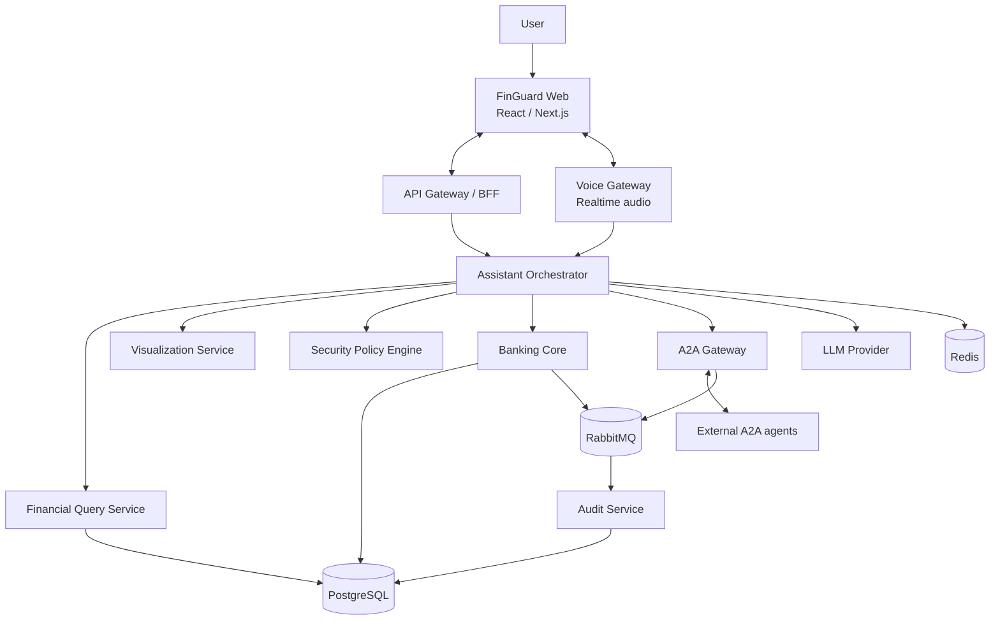
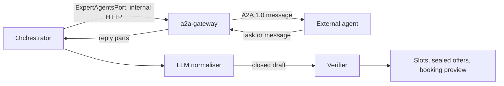
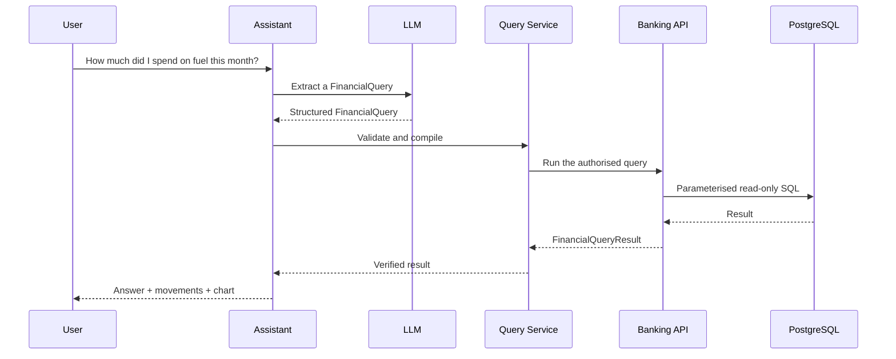
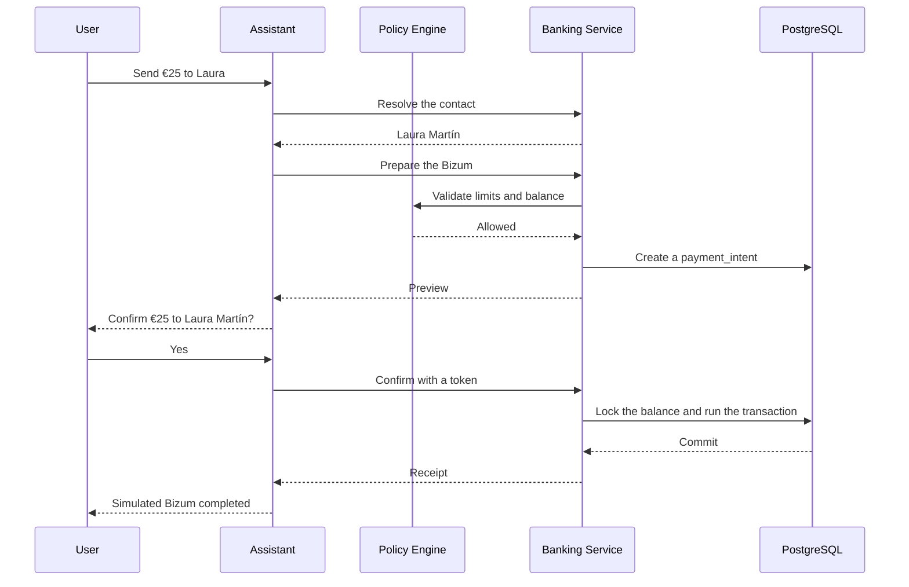

# FinGuard Engine

> Functional and technical specification

## Table of contents

1. [Executive summary](#1-executive-summary)
2. [Product vision](#2-product-vision)
3. [Objectives](#3-objectives)
4. [Design principles](#4-design-principles)
5. [Overall architecture](#5-overall-architecture)
6. [Microservice strategy](#6-microservice-strategy)
7. [A2A readiness](#7-a2a-readiness)
8. [Database](#8-database)
9. [Financial query engine](#9-financial-query-engine)
10. [Visualisation engine](#10-visualisation-engine)
11. [Secure Bizum flow](#11-secure-bizum-flow)
12. [Security](#12-security)
13. [Initial external contracts](#13-initial-external-contracts)
14. [Technologies](#14-technologies)
15. [Repository structure](#15-repository-structure)
16. [Main demo scenario](#16-main-demo-scenario)
17. [Initial architectural decisions](#17-initial-architectural-decisions)
18. [Risks](#18-risks)
19. [Definition of done](#19-definition-of-done)
20. [Pitch](#20-pitch)

The phases, dates and success metrics live in [roadmap.md](roadmap.md).

---

## 1. Executive summary

**FinGuard** is a conversational, modular and secure financial engine that lets users query banking information and prepare operations through natural language.

Users will be able to interact by text or voice to:

- Check their balance.
- Analyse financial movements.
- Ask temporal and comparative questions.
- Prepare and confirm simulated Bizum transfers.
- Obtain dynamically generated visualisations.
- Hold contextual conversations about their finances.

The system is designed from the start to grow into a complete financial assistant and to interoperate with external agents through the Agent-to-Agent protocol — A2A.

Security is a structural property of the system, not a layer added afterwards. The generative model may interpret intent and write answers, but it has **no** direct access to the database and no autonomous ability to move money.

> **FinGuard interprets. Deterministic services validate. The user authorises. The system executes.**

---

## 2. Product vision

### 2.1. Value proposition

FinGuard lets users deal with their finances through a natural conversation, removing the need to navigate menus and filters.

Examples:

> «¿Cuánto he gastado en gasolina este mes?»
>
> «¿Y cuánto gasté el mes anterior?»
>
> «Compáralo por semanas.»
>
> «¿Qué movimiento explica el aumento?»
>
> «Envía 25 euros por Bizum a Laura para la cena.»

The system must answer using verifiable information and show the movements that back each figure.

### 2.2. Planned evolution

```text
FinGuard Engine
    │
    ├── FinGuard Assistant
    │      Conversational application for the customer
    │
    ├── FinGuard Voice
    │      Real-time voice interaction
    │
    ├── FinGuard Insights
    │      Queries, analysis and visualisations
    │
    ├── FinGuard Actions
    │      Controlled financial operations
    │
    └── FinGuard Connect
           A2A interoperability with external agents
```

---

## 3. Objectives

### 3.1. Functional objectives

- Support conversations by text and voice.
- Report the available balance.
- Query and aggregate movements through natural language.
- Resolve temporal references such as:
  - Today.
  - This week.
  - Last month.
  - The last three months.
- Keep context across successive messages.
- Prepare and confirm simulated Bizum operations.
- Generate a visualisation suited to each answer.
- Show where the results came from.
- Record the relevant decisions and operations.
- Expose selected capabilities through A2A.

### 3.2. Technical objectives

- Keep probabilistic reasoning and deterministic execution separate.
- Design replaceable services behind explicit contracts.
- Avoid direct dependencies between the domain and the AI providers.
- Guarantee idempotency in financial operations.
- Keep an immutable financial record.
- Require human authorisation before any movement.
- Allow replacing:
  - The LLM provider.
  - The voice provider.
  - The analytical database.
  - The visualisation system.
  - The simulated banking API.
- Prepare the system to act as both an A2A client and an A2A server.

### 3.3. Out of initial scope

- Real banking operations.
- Regulated financial advice.
- Investments or asset trading.
- Automatic loan applications.
- Access to real bank accounts.
- Autonomous financial decisions without confirmation.
- Training a foundation model of our own.
- Microservices deployed on Kubernetes during the first phase.

---

## 4. Design principles

### 4.1. Security by design

Every financial action must go through:

```text
Intent
   ↓
Validated structure
   ↓
Security policy
   ↓
Preview
   ↓
Explicit confirmation
   ↓
Idempotent execution
   ↓
Audit
```

### 4.2. The LLM is not a source of truth

The model **may**:

- Interpret intent.
- Extract parameters.
- Select a tool.
- Explain results.
- Propose a visualisation.

The model **may not**:

- Invent balances or amounts.
- Query the banking tables directly.
- Build SQL without validation.
- Modify financial records.
- Confirm an operation on the user's behalf.
- Alter security rules.
- Decide whether an operation has already been authorised.

### 4.3. Contracts before implementations

Every capability is defined behind its own contract:

```python
class BankingPort(Protocol):
    async def get_balance(self, account_id: UUID) -> Balance:
        ...

    async def prepare_bizum(
        self,
        command: PrepareBizumCommand,
    ) -> PaymentPreview:
        ...

    async def confirm_bizum(
        self,
        command: ConfirmBizumCommand,
    ) -> PaymentReceipt:
        ...
```

The orchestrator knows the contract, not the database nor the implementation details.

### 4.4. Separating domain from protocols

Internal objects do not depend on:

- A2A.
- OpenAI.
- Gemini.
- FastAPI.
- PostgreSQL.
- RabbitMQ.
- Vega-Lite.

Protocols and providers are implemented as external adapters.

---

## 5. Overall architecture



---

## 6. Microservice strategy

The system is designed as independent services, but that logical separation does not force each module into its own container from day one.

### 6.1. Deployable services

#### 6.1.1. `finguard-orchestrator`

Responsibilities:

- Keeping the conversational context.
- Classifying intent.
- Coordinating tools.
- Producing answers.
- Handling visualisation requests.
- Applying the conversational rules.
- Integrating with LLM providers.

It does not own accounts or banking movements.

#### 6.1.2. `finguard-banking`

Responsibilities:

- Managing fictional accounts.
- Keeping the ledger.
- Reporting balances.
- Exposing movements.
- Managing contacts.
- Preparing Bizum operations.
- Confirming operations.
- Applying idempotency.
- Publishing financial events.

It is the only service with write permission over the financial data.

#### 6.1.3. `finguard-voice`

Responsibilities:

- Receiving streaming audio.
- Detecting the end of a turn.
- Transcribing.
- Handling barge-in.
- Synthesising the answer.
- Keeping realtime sessions.

It knows nothing about the banking domain.

#### 6.1.4. `finguard-a2a`

Responsibilities:

- Publishing the Agent Card.
- Acting as an A2A server.
- Acting as an A2A client.
- Discovering authorised agents.
- Translating A2A tasks into internal commands.
- Translating internal results into A2A artifacts.
- Managing the state and traceability of external tasks.

#### 6.1.5. `finguard-audit`

Responsibilities:

- Consuming domain events.
- Keeping an append-only audit trail.
- Recording accesses, queries and operations.
- Providing traceability for the demo and the evaluation.

#### 6.1.6. `finguard-web`

Responsibilities:

- Chat.
- Audio capture and playback.
- Visualisations.
- Operation confirmations.
- Displaying the movements that were used.
- Tool and task state.

### 6.2. Recommended initial deployment

To avoid premature complexity:

```text
Initial phase
├── finguard-web
├── finguard-orchestrator
├── finguard-banking
└── PostgreSQL

Intermediate phase
├── finguard-voice
├── RabbitMQ
└── finguard-audit

Advanced phase
└── finguard-a2a
```

Even if some modules initially share a process, their contracts and dependencies must allow separating them without touching the domain.

---

## 7. A2A readiness

### 7.1. The role of A2A

A2A is used to interoperate with external agents, not as a replacement for every internal protocol.

The standard defines concepts such as Agent Card, Task, Message, Part and Artifact. A task represents a unit of work with state, while concrete results must be returned as artifacts attached to the task.

FinGuard is an **A2A client**: it asks external agents for what they know — in the PoC, a gym's class timetable and a booking — and checks every answer before the person sees it. It is a consumer only: it publishes no Agent Card of its own, has no inbound A2A route and no push-notification webhook.

The **server role** — an external agent requesting a capability from FinGuard — is future work. If it ever comes, it will never expose payments (§7.8). Where other sections of this document describe FinGuard serving A2A (§3, §6.1.4, §8.2, §16), they describe that future work.

The decision, its known limits and its measures are in [ADR-012](architecture/adr-012-a2a-consumer-gateway.md).

### 7.2. A2A gateway



`apps/a2a-gateway` is the only process that speaks A2A. It holds the registry of trusted agents, validates their cards, presents their credentials and bounds their replies; it has no LLM, no banking client and no conversation state. The orchestrator reaches it through the domain port `ExpertAgentsPort` and never receives A2A SDK objects:

```text
Verified query
    ↓ template: Spanish text plus the same data as JSON
A2A Message
    ↓ external agent
A2A Task or Message, parsed by the SDK
    ↓ LLM normaliser: a closed schema, no field for an amount, an account or a URL
Draft
    ↓ verifier: every value grounded in the reply, or the whole reply is dropped
Domain slots or a booking receipt
```

A new agent is one URL in `A2A_GATEWAY_AGENTS`. No code anywhere is written for a particular provider: the model reads each agent's own vocabulary into FinGuard's one shape, and the code decides whether to believe it.

### 7.3. Agent Card

FinGuard publishes no card. It reads the card of each registered agent at its well-known path:

```text
/.well-known/agent-card.json
```

The Agent Card describes identity, interfaces, capabilities, authentication requirements and skills. The gateway resolves it with the SDK and validates it against A2A 1.0 before anything else reads it. An agent is usable only when its card parses as a 1.0 card with its required fields, declares a 1.x interface over JSON-RPC or HTTP+JSON on the registered host, declares at least one skill, and asks for an authentication scheme FinGuard supports with a credential it holds. Otherwise it is listed as unusable with a closed reason (`card_unreachable`, `card_invalid`, `version_unsupported`, `binding_unsupported`, `interface_untrusted`, `no_skills`, `auth_unsupported`, `credential_missing`) and never asked. Cards are read again after a time to live (300 s by default).

The model classifies each card's skills into a closed catalogue — `AVAILABILITY`, `BOOKING` or none — and a classification error leaves the agent without that capability, never with a guessed one.

If FinGuard ever publishes a card of its own (§7.8), it will not include:

- Internal topology.
- Table names.
- Prompts.
- Credentials.
- Personal identifiers.
- Administrative capabilities.
- Any payment skill.

### 7.4. Concept mapping

| A2A | FinGuard |
| --- | --- |
| Agent Card | An external agent's identity, interfaces, security and skills, validated before use |
| Skill | Classified into a closed capability: availability, booking or none |
| `contextId` | Kept per agent with the sealed offers, so a booking continues its search's context |
| Task | One search or one booking at one agent |
| TaskState | `COMPLETED`, `INPUT_REQUIRED` (alternatives to a full class), `AUTH_REQUIRED` (link a membership), `FAILED`, `REJECTED`, `CANCELED` |
| Message | The template FinGuard sends: text, plus a `data` part when the agent accepts JSON |
| Artifact and Part | The reply's text and data parts, normalised and verified; `file` parts are dropped and counted |

### 7.5. Capabilities consumed

- `AVAILABILITY` — an agent's sessions of one activity inside a window and a daily band.
- `BOOKING` — one place in one offered session, sent only after the person confirms it.

No FinGuard skill is exposed. The server skills once listed here (balance, movements, spending analysis, visualisation, Bizum preparation and payment status) are not built, and the payment ones are withdrawn.

### 7.6. A2A security

A2A declares authentication requirements in the Agent Card, while credentials travel through standard web mechanisms kept separate from the message content.

As a client, FinGuard applies:

- A private registry of allowed agents (`A2A_GATEWAY_AGENTS`); no open discovery.
- Conformance before use: a card that does not meet A2A 1.0 makes its agent unusable.
- Credentials discovered from the card's `securitySchemes` (an `apiKey` header or `http` bearer), presented only in headers and only to interfaces on the registered host. OAuth 2.0, OpenID Connect and mutual TLS are not supported yet: such an agent is `auth_unsupported`.
- Outgoing data limited to the activity, the window, the slot reference and a pairwise member reference that differs at every agent — never a name, an account, a balance or the person's sentence.
- Request limits: 16 KiB of text and 64 KiB of data per reply, 10 s per call, a per-agent budget in the orchestrator, no retries.
- Full validation of incoming data: the SDK parses every reply, the model's reading is a closed schema, and the verifier accepts only values the reply states. Reply text is never shown raw and never reaches a prompt, the planner or the payment path, so instructions inside it have nowhere to go.
- A booking needs a typed confirmation on screen and the `agents:book` scope, and it is never re-sent.
- No payment through an external agent.

Agent Card signatures are not verified: the registry is the trust anchor. HTTPS is a deployment requirement; the development stack reaches its simulated agents over HTTP on its internal network.

### 7.7. Implementation

The official Python SDK is used: `a2a-sdk` 1.2.1, which implements A2A 1.0. The gateway uses its client side; only `apps/simulated-gym-agent`, which stands in for third parties, uses its server side.

The implementation uses:

- A2A 1.0
- JSON-RPC and HTTP+JSON bindings
- Blocking (non-streaming) sends; no SSE, no push notifications
- Each agent's Agent Card at its well-known URI

The compose profile `a2a` (`just a2a`) starts the gateway and three simulated gyms: two that answer the same question in different formats, and one with an A2A 0.3 card that the gate refuses. `just evaluate-a2a` measures the normaliser.

### 7.8. The server role, if it comes

Exposing FinGuard's own skills to other agents is future work and is never payments. It would require, at least:

- Mandatory HTTPS.
- OAuth 2.0 or OpenID Connect.
- Per-skill scopes.
- Audience and issuer verification.
- Short-lived tokens.
- Request limits.
- Correlation IDs.
- Full validation of incoming data.
- An allowlist of agents.
- Rejection of instructions that try to alter internal policies.
- A decision of its own, recorded as an ADR.

A2A v1.0 adds version and capability negotiation for verifying Agent Card signatures; a published card would leave room for both mechanisms.

---

## 8. Database

### 8.1. Choice

**PostgreSQL 18** is used, or the latest stable version supported by the deployment environment.

The choice rests on:

- ACID transactions.
- Relational constraints.
- Foreign keys.
- Row locking.
- Configurable isolation levels.
- Exact numeric types.
- JSONB support.
- B-tree, GIN and other indexes.
- Row-Level Security.
- Good support in Python and in observability tooling.

PostgreSQL can apply per-row security policies, restricting which records each role may select or modify; if RLS is enabled and no policy applies, the default is to deny.

JSONB may be used for variable metadata and supports GIN indexing, but it does not replace relational columns for critical fields.

### 8.2. Data ownership per service

Every service owns its data.

```text
finguard-banking-db
├── customers
├── accounts
├── ledger_transactions
├── ledger_entries
├── balance_projections
├── contacts
├── payment_intents
├── idempotency_records
└── outbox_events

finguard-orchestrator-db
├── conversations
├── messages
├── tool_executions
├── query_plans
└── visualization_specs

finguard-a2a-db
├── remote_agents
├── a2a_tasks
├── a2a_task_events
├── a2a_artifacts
└── a2a_credentials_metadata

finguard-audit-db
├── audit_events
└── integrity_checkpoints
```

During the competition they may live in a single PostgreSQL cluster with:

- Separate databases or schemas.
- Different users.
- Different credentials.
- Minimum privileges.
- No direct cross access.

### 8.3. Financial model

A single mutable column called `balance` is not used on its own.

A double-entry ledger is implemented:

```text
Bizum operation of €25
    ├── Debit:  user account         2,500 minor units
    └── Credit: clearing account     2,500 minor units
```

Every transaction must balance:

$$\sum \text{debits} = \sum \text{credits}$$

### 8.4. Monetary representation

Amounts are stored as:

```sql
amount_minor BIGINT NOT NULL
currency CHAR(3) NOT NULL
```

Example:

```text
25.49 EUR → amount_minor = 2549
```

`FLOAT`, `REAL` and `DOUBLE PRECISION` are **not** used to represent money.

PostgreSQL also offers the `NUMERIC` type, which represents exact values with selectable precision. FinGuard prefers integer minor units in the ledger and `Decimal` in the application layer.

### 8.5. Main tables

#### `accounts`

```sql
CREATE TABLE accounts (
    id UUID PRIMARY KEY,
    customer_id UUID NOT NULL,
    account_reference VARCHAR(64) NOT NULL UNIQUE,
    currency CHAR(3) NOT NULL,
    status VARCHAR(30) NOT NULL,
    created_at TIMESTAMPTZ NOT NULL DEFAULT NOW(),
    version BIGINT NOT NULL DEFAULT 0
);
```

#### `ledger_transactions`

```sql
CREATE TABLE ledger_transactions (
    id UUID PRIMARY KEY,
    transaction_type VARCHAR(40) NOT NULL,
    status VARCHAR(30) NOT NULL,
    reference VARCHAR(120) NOT NULL UNIQUE,
    description TEXT,
    metadata JSONB NOT NULL DEFAULT '{}',
    occurred_at TIMESTAMPTZ NOT NULL,
    created_at TIMESTAMPTZ NOT NULL DEFAULT NOW()
);
```

#### `ledger_entries`

```sql
CREATE TABLE ledger_entries (
    id UUID PRIMARY KEY,
    transaction_id UUID NOT NULL
        REFERENCES ledger_transactions(id),
    account_id UUID NOT NULL
        REFERENCES accounts(id),
    entry_type VARCHAR(10) NOT NULL
        CHECK (entry_type IN ('DEBIT', 'CREDIT')),
    amount_minor BIGINT NOT NULL
        CHECK (amount_minor > 0),
    currency CHAR(3) NOT NULL,
    created_at TIMESTAMPTZ NOT NULL DEFAULT NOW()
);
```

#### `balance_projections`

```sql
CREATE TABLE balance_projections (
    account_id UUID PRIMARY KEY
        REFERENCES accounts(id),
    available_minor BIGINT NOT NULL,
    booked_minor BIGINT NOT NULL,
    currency CHAR(3) NOT NULL,
    version BIGINT NOT NULL,
    updated_at TIMESTAMPTZ NOT NULL
);
```

The ledger is the source of truth. `balance_projections` is a read-optimised projection.

#### `payment_intents`

```sql
CREATE TABLE payment_intents (
    id UUID PRIMARY KEY,
    account_id UUID NOT NULL REFERENCES accounts(id),
    recipient_id UUID NOT NULL,
    amount_minor BIGINT NOT NULL CHECK (amount_minor > 0),
    currency CHAR(3) NOT NULL,
    concept VARCHAR(140),
    status VARCHAR(30) NOT NULL,
    expires_at TIMESTAMPTZ NOT NULL,
    idempotency_key VARCHAR(120) NOT NULL UNIQUE,
    created_at TIMESTAMPTZ NOT NULL DEFAULT NOW(),
    confirmed_at TIMESTAMPTZ,
    executed_at TIMESTAMPTZ
);
```

States:

- `DRAFT`
- `AWAITING_CONFIRMATION`
- `AUTHORIZED`
- `EXECUTING`
- `EXECUTED`
- `REJECTED`
- `EXPIRED`
- `FAILED`

#### `outbox_events`

```sql
CREATE TABLE outbox_events (
    id UUID PRIMARY KEY,
    aggregate_type VARCHAR(80) NOT NULL,
    aggregate_id UUID NOT NULL,
    event_type VARCHAR(120) NOT NULL,
    payload JSONB NOT NULL,
    occurred_at TIMESTAMPTZ NOT NULL,
    published_at TIMESTAMPTZ,
    retry_count INTEGER NOT NULL DEFAULT 0
);
```

The event is written in the same transaction that modifies the domain. A relay publishes it to RabbitMQ afterwards. This pattern avoids committing the operation to the database and losing the event before publishing it, though consumers must be idempotent because an event may be delivered more than once.

### 8.6. Data for the assistant's queries

The LLM never reaches the ledger.

The banking service exposes a limited view:

```sql
CREATE VIEW assistant_read.transactions_v1 AS
SELECT
    lt.id AS transaction_id,
    le.account_id,
    lt.occurred_at,
    lt.description,
    lt.transaction_type,
    le.amount_minor,
    le.currency,
    lt.metadata ->> 'merchant_name' AS merchant_name,
    lt.metadata ->> 'category' AS category
FROM ledger_transactions lt
JOIN ledger_entries le
    ON le.transaction_id = lt.id
WHERE lt.status = 'BOOKED';
```

A dedicated role `finguard_query_reader` is created, with these restrictions:

- `SELECT` only.
- Authorised views only.
- No access to payment tables.
- No access to credentials or full personal data.
- `statement_timeout`.
- A maximum row limit.
- Row-Level Security per customer.
- A read-only connection.

### 8.7. Initial indexes

```sql
CREATE INDEX idx_ledger_entries_account
    ON ledger_entries(account_id);

CREATE INDEX idx_transactions_occurred_at
    ON ledger_transactions(occurred_at);

CREATE INDEX idx_transactions_type_date
    ON ledger_transactions(transaction_type, occurred_at);

CREATE INDEX idx_transactions_metadata
    ON ledger_transactions
    USING GIN(metadata);

CREATE INDEX idx_payment_intents_account_status
    ON payment_intents(account_id, status);
```

---

## 9. Financial query engine

### 9.1. Flow



### 9.2. Intermediate representation

```json
{
  "intent": "QUERY_TRANSACTIONS",
  "metric": "SUM",
  "direction": "EXPENSE",
  "categories": ["TRANSPORT_FUEL"],
  "dateRange": {
    "from": "2026-07-01",
    "to": "2026-07-31"
  },
  "groupBy": null,
  "comparison": null
}
```

### 9.3. Compilation

The representation is validated with Pydantic and turned into parameterised SQL.

An SQL string produced by the LLM is never executed directly.

To meet the natural-language-to-SQL objective, the following are kept:

- The original question.
- The structured plan.
- The compiled SQL.
- The parameters.
- The result.
- The validation.
- The execution time.

This makes it possible to measure accuracy and to show traceability in the report.

---

## 10. Visualisation engine

### 10.1. Input

The engine receives only data that has already been computed:

```json
{
  "question": "Compara mi gasto en gasolina por semanas",
  "columns": [
    {"name": "week", "type": "temporal"},
    {"name": "amount", "type": "quantitative"}
  ],
  "rows": [
    {"week": "2026-07-06", "amount": 34.20},
    {"week": "2026-07-13", "amount": 62.00},
    {"week": "2026-07-20", "amount": 31.23}
  ]
}
```

### 10.2. Output

```json
{
  "format": "vega-lite",
  "reason": "The query compares a magnitude over time",
  "specification": {}
}
```

### 10.3. Validations

- A valid Vega-Lite schema.
- No arbitrary JavaScript.
- No external resources.
- Only fields present in the data.
- A maximum number of marks.
- No invented titles.
- Axes consistent with the types.
- No chart when a KPI card would suit better.

---

## 11. Secure Bizum flow



To confirm an operation:

1. A transaction is opened.
2. The idempotency key is checked.
3. The balance projection is locked with `SELECT ... FOR UPDATE`.
4. Balance and expiry are checked.
5. The balanced entries are created.
6. The projection is updated.
7. The event is inserted into `outbox_events`.
8. The transaction is committed.

PostgreSQL can lock the selected rows against concurrent updates with `FOR UPDATE`.

For particularly sensitive operations, `SERIALIZABLE` isolation may be used, retrying when PostgreSQL detects a conflict.

---

## 12. Security

### 12.1. Security layers

```text
Identity
    ↓
Authorisation
    ↓
Structural validation
    ↓
Financial policies
    ↓
Human confirmation
    ↓
Secure transaction
    ↓
Audit
```

### 12.2. Main measures

- OAuth 2.0 / OpenID Connect.
- Short-lived tokens.
- Per-operation scopes.
- TLS encryption.
- Secrets kept out of the code.
- Separate PostgreSQL roles.
- Row-Level Security.
- Query limits.
- Rate limiting.
- Input sanitisation.
- Pydantic validation.
- Parameterised SQL.
- Idempotency.
- A record of every tool invoked.
- Masking of phone numbers and identifiers.
- No full audio recorded by default.
- No more data sent to the LLM than necessary.
- Explicit confirmation for operations.
- Expiring previews.
- Deny by default.

### 12.3. Prompt injection protection

Messages coming from users or external agents are treated as untrusted data.

A message **may not**:

- Change the system prompt.
- Modify policies.
- Grant itself permissions.
- Create scopes.
- Confirm an operation without proof of authorisation.
- Request credentials.
- Alter the audit trail.
- Turn an external result into an internal instruction.

External data is wrapped as content, never as system instructions.

### 12.4. Audit

Every event carries:

```json
{
  "eventId": "uuid",
  "eventType": "PAYMENT_CONFIRMED",
  "actorType": "CUSTOMER",
  "actorId": "customer-id",
  "correlationId": "conversation-id",
  "operationId": "payment-id",
  "timestamp": "2026-09-01T18:23:17Z",
  "result": "SUCCESS",
  "metadata": {}
}
```

Events are append-only and can be chained through hashes so later modifications are detectable.

---

## 13. Initial external contracts

### 13.1. Balance

```http
GET /v1/accounts/{account_id}/balance
```

```json
{
  "accountId": "uuid",
  "availableMinor": 146035,
  "bookedMinor": 146035,
  "currency": "EUR",
  "asOf": "2026-07-30T09:30:00Z"
}
```

### 13.2. Movement query

```http
POST /v1/financial-queries
```

```json
{
  "accountId": "uuid",
  "metric": "SUM",
  "direction": "EXPENSE",
  "categories": ["TRANSPORT_FUEL"],
  "dateRange": {
    "from": "2026-07-01",
    "to": "2026-07-31"
  },
  "groupBy": "WEEK"
}
```

### 13.3. Bizum preparation

```http
POST /v1/bizum/intents
Idempotency-Key: 8710b0d8-...
```

### 13.4. Confirmation

```http
POST /v1/bizum/intents/{intent_id}/confirm
```

```json
{
  "confirmationToken": "short-lived-token"
}
```

---

## 14. Technologies

| Component | Technology |
| --- | --- |
| Frontend | React or Next.js + TypeScript |
| Backend | Python 3.12+ |
| API framework | FastAPI |
| Validation | Pydantic |
| ORM and SQL access | SQLAlchemy 2 |
| Migrations | Alembic |
| Database | PostgreSQL |
| Cache and sessions | Redis |
| Messaging | RabbitMQ |
| Visualisation | Vega-Lite |
| A2A | Official Python SDK |
| Observability | OpenTelemetry |
| Metrics | Prometheus |
| Technical dashboards | Grafana |
| Containers | Docker Compose |
| Tests | Pytest |
| Frontend tests | Vitest and Playwright |

---

## 15. Repository structure

A single monorepo (`finguard`) with autonomous, independently deployable projects. The full structure, the tooling and the dependency rules live in [architecture/monorepo.md](architecture/monorepo.md); the development rules in [architecture/development-rules.md](architecture/development-rules.md).

Minimum structure for the first iteration:

```text
finguard/
├── apps/
│   ├── web/
│   ├── orchestrator/
│   └── banking-api/
├── packages/
│   └── contracts/
├── infrastructure/
│   └── postgres/
├── tests/
│   └── e2e/
├── docs/
│   ├── vision.md
│   ├── roadmap.md
│   ├── architecture/
│   └── adr/
├── compose.yaml
├── nx.json
├── package.json
├── pnpm-workspace.yaml
└── README.md
```

---

## 16. Main demo scenario

1. The user asks about their fuel spending.
2. FinGuard obtains a verifiable result.
3. The amount and the movements behind it are shown.
4. A time-series chart is generated.
5. The user asks about the previous month.
6. FinGuard keeps the context.
7. The user asks for a weekly comparison.
8. The chart is regenerated.
9. The user prepares a Bizum.
10. FinGuard shows the recipient, the amount and the resulting balance.
11. The user confirms.
12. The simulated operation is executed.
13. The receipt and the audit trail are shown.
14. Optionally, an external agent queries a skill through A2A.

---

## 17. Initial architectural decisions

### ADR-001 — PostgreSQL as the transactional store

**Status:** accepted.

PostgreSQL is the source of truth for accounts, movements and operations.

### ADR-002 — Immutable ledger

**Status:** accepted.

Booked movements are never modified or deleted. Corrections are represented as new compensating transactions.

### ADR-003 — Double entry

**Status:** accepted.

Every financial operation has balanced debits and credits.

### ADR-004 — No direct data access for the LLM

**Status:** accepted.

The LLM works through validated tools and contracts.

### ADR-005 — Human confirmation

**Status:** accepted.

Every operation that moves money requires explicit confirmation.

### ADR-006 — A2A as an adapter

**Status:** accepted.

Domain models do not depend on the A2A protocol.

### ADR-007 — Microservices by capability

**Status:** accepted.

Services are split by business responsibility, not by small technical functions.

### ADR-008 — Money in minor units

**Status:** accepted.

Amounts are represented with integers and a currency code.

---

## 18. Risks

| Risk | Mitigation |
| --- | --- |
| Incorrect text-to-SQL | An intermediate plan and a deterministic compiler |
| Invented data | Answers backed exclusively by tools |
| Duplicate operation | Idempotency key and a unique constraint |
| Race condition on the balance | Row locking or serializable isolation |
| Prompt injection | Separation of instructions, data and policies |
| Too many microservices | Logical separation and progressive deployment |
| Voice latency | Streaming and progress indicators |
| LLM provider outage | A replaceable provider interface |
| Invalid chart | Validation and a safe fallback |
| A2A widening the scope too much | Only two skills implemented for the competition |
| Running out of time | Text, queries and Bizum before A2A |

---

## 19. Definition of done

FinGuard is ready for submission when:

- The system starts through Docker Compose.
- A reproducible financial dataset exists.
- The main queries pass the benchmark.
- The balance is derived from the ledger.
- Bizum requires confirmation.
- Idempotency is proven.
- Charts are generated and validated.
- The conversation works by text.
- Voice works, or a reliable text fallback exists.
- The audit trail allows reconstructing an operation.
- An external agent's card is discovered and validated against A2A 1.0.
- At least one A2A skill works.
- The video lasts no more than three minutes.
- The report describes architecture, security, results and limitations.

---

## 20. Pitch

**FinGuard** is a conversational financial engine built on principles of security, traceability and interoperability. It turns natural language into verifiable queries, generates dynamic visualisations and runs simulated operations through controlled flows, always keeping probabilistic reasoning, user authorisation and banking execution apart. Its modular architecture allows it to grow into a complete assistant and to connect with external agents through A2A.
